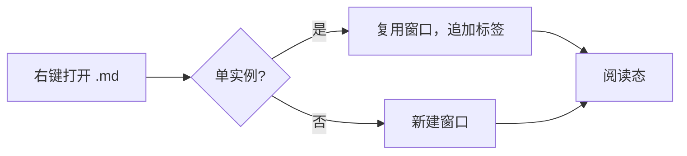
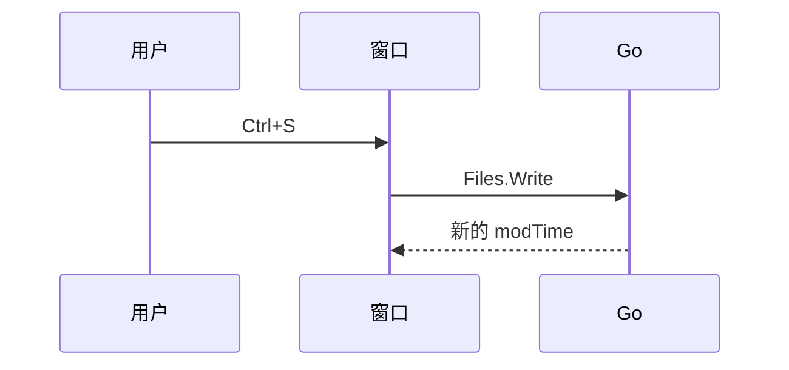

---
title: MDReader 全格式回归样例
author: fivenull
tags: [markdown, 回归用例, mdreader]
draft: false
---

# 一级标题：全格式回归

这份文件是 MDReader 的回归用例，每一项都必须渲染正确。它同时使用 **CRLF 换行** 与 **UTF-8 BOM**，用来验证保存后字节不被改动。

## 行内元素

常规文字、**粗体**、*斜体*、***粗斜体***、~~删除线~~、`行内代码`、[链接](https://example.com)、自动链接 https://mygo.run 、<kbd>Ctrl</kbd> + <kbd>E</kbd>。

行内公式 $E = mc^2$，行内公式的上下标 $a_i^2 + b_j^2 = c^2$。

引用中的行内元素：引用里的 **粗体** 与 `代码`。

## 标题层级

### 三级标题

#### 四级标题

##### 五级标题

###### 六级标题

## 列表

- 无序项一
- 无序项二
  - 嵌套项
  - 嵌套项
    - 再嵌一层
- 无序项三

1. 有序项一
2. 有序项二
   1. 嵌套有序
   2. 嵌套有序
3. 有序项三

### 任务列表

- [ ] 未完成的任务
- [x] 已完成的任务
- [x] 带 **行内格式** 的已完成任务
- [ ] 另一个未完成任务

## 表格

| 左对齐 | 居中 | 右对齐 | 说明 |
| :----- | :--: | -----: | ---- |
| 苹果 | 🍎 | 1 | 普通单元格 |
| 香蕉 | 🍌 | 22 | 含 `代码` |
| 长文本 | 内容 | 333 | 用来测试横向溢出时的滚动表现 |

## 代码块

```ts
import { Files } from "./mygo";

export async function openDocument(path: string) {
  const file = await Files.read(path);
  return { path: file.path, size: file.content.length };
}
```

```go
package main

import "github.com/egoist/mygo"

func main() {
	mygo.App.WhenReady(func() {
		mygo.NewWindow(mygo.WindowOptions{Title: "MDReader", URL: "/"})
	})
	if err := mygo.App.Run(); err != nil {
		panic(err)
	}
}
```

```css
.preview {
  max-width: 760px;
  line-height: 1.75;
}
```

```python
def fib(n: int) -> int:
    return n if n < 2 else fib(n - 1) + fib(n - 2)
```

```json
{ "name": "MDReader", "version": "0.1.0", "fileAssociations": ["md"] }
```

```
没有语言标记的代码块，应当按等宽文本原样显示。
```

## 数学公式

行间公式：

$$
\int_{-\infty}^{\infty} e^{-x^2} \, dx = \sqrt{\pi}
$$

矩阵与对齐：

$$
\begin{pmatrix} a & b \\ c & d \end{pmatrix}
\begin{pmatrix} x \\ y \end{pmatrix}
=
\begin{pmatrix} ax + by \\ cx + dy \end{pmatrix}
$$

## Mermaid 图表





## 裸 HTML

<table>
  <thead><tr><th>来源</th><th>优先级</th></tr></thead>
  <tbody>
    <tr><td>文件本身</td><td>最高</td></tr>
    <tr><td>目录默认配置</td><td>中</td></tr>
    <tr><td>全局配置</td><td>低</td></tr>
  </tbody>
</table>

<details>
  <summary>点开看看折叠块</summary>

  折叠内容支持 **Markdown** 吗？——不支持，这里渲染的是原始 HTML。

</details>

<p align="center"><strong>居中的一段 HTML</strong></p>

以下内容必须被剥离：<script>alert("xss")</script>、、<a href="javascript:alert(1)">危险链接</a>。

## 图片

相对路径图片：


## 引用与分隔线

> 一级引用
>
> > 嵌套引用
>
> 引用里的列表：
>
> 1. 第一项
> 2. 第二项

---

## 脚注

这里有一个脚注引用[^1]，还有第二个[^note]。

[^1]: 第一个脚注的内容。
[^note]: 第二个脚注，带 `代码`。

## 超长行测试

这是一段特别长的文本，用来测试自动换行与阅读宽度是否正常：Markdown 阅读器需要在窄窗口下保持舒适的行长，同时不把中英文混排的内容挤成难以阅读的细长条，因此在预览面板里使用最大宽度约束，并在窗口变宽时保持居中的阅读列。

## 链接清单

- [CommonMark 规范](https://commonmark.org/)
- [MyGo 文档](https://github.com/egoist/mygo)
- [KaTeX 支持的函数](https://katex.org/docs/supported.html)
- 邮箱自动识别：someone@example.com
